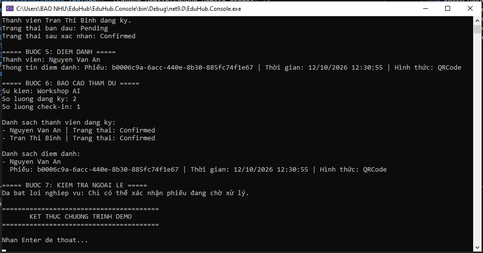

# EduHub - Hệ thống quản lý Câu lạc bộ và Sự kiện

## 1. Tổng quan dự án

EduHub là ứng dụng Console được phát triển bằng C# và .NET cho bài tập môn IN4211 – Phát triển phần mềm hướng đối tượng. Dự án minh họa cách thiết kế hướng đối tượng và quản lý cơ bản các câu lạc bộ, thành viên và sự kiện.

## 2. Thiết kế Domain

Dự án bao gồm năm lớp domain chính:

- **Member:** Đại diện cho thành viên, lưu trữ thông tin cá nhân và trạng thái hoạt động.
- **Club:** Đại diện cho câu lạc bộ và quản lý danh sách thành viên.
- **Event:** Đại diện cho sự kiện do câu lạc bộ tổ chức và kiểm tra sức chứa của sự kiện.
- **Registration:** Đại diện cho phiếu đăng ký tham gia sự kiện của thành viên và quản lý trạng thái đăng ký.
- **CheckIn:** Ghi nhận thông tin điểm danh của thành viên tại sự kiện.

Enum `RegistrationStatus` biểu diễn các trạng thái đăng ký gồm `Pending`, `Confirmed` và `Cancelled`. Enum `CheckInMethod` biểu diễn hình thức điểm danh.

## 3. Cấu trúc dự án

- `EduHub.Console/`: Chứa ứng dụng Console và chương trình demo.
- `EduHub.Domain/`: Chứa các lớp domain và quy tắc nghiệp vụ.
- `docs/user-stories.md`: Chứa User Story và các yêu cầu nghiệp vụ.
- `docs/class-diagram.md`: Chứa sơ đồ lớp domain.

## 4. Yêu cầu kỹ thuật

- Ứng dụng Console sử dụng .NET.
- Bật Nullable Reference Types.
- Sử dụng Factory Method để khởi tạo đối tượng.
- Kiểm tra dữ liệu đầu vào và triển khai hành vi nghiệp vụ.
- Bổ sung XML Documentation cho các API công khai.

## 5. Hướng dẫn chạy chương trình

### Cách 1: Chạy bằng Visual Studio

1. Mở file `EduHub.sln` bằng Visual Studio.
2. Chọn `EduHub.Console` làm dự án khởi chạy (Startup Project).
3. Build solution để kiểm tra lỗi biên dịch.
4. Chạy chương trình bằng **Ctrl + F5** hoặc lệnh Run trong Visual Studio.
5. Theo dõi kết quả trên Console, bao gồm quá trình tạo câu lạc bộ, đăng ký thành viên, xác nhận đăng ký sự kiện, điểm danh và báo cáo tham dự.

### Cách 2: Chạy bằng Terminal

Mở Terminal tại thư mục chứa file `EduHub.Console.csproj`, sau đó chạy lệnh:

```bash
dotnet run
```

## 6. Kết quả chạy chương trình



## 7. Thông tin tác giả

- **Mã số sinh viên:** 0024415701
- **Môn học:** IN4211 – Phát triển phần mềm hướng đối tượng